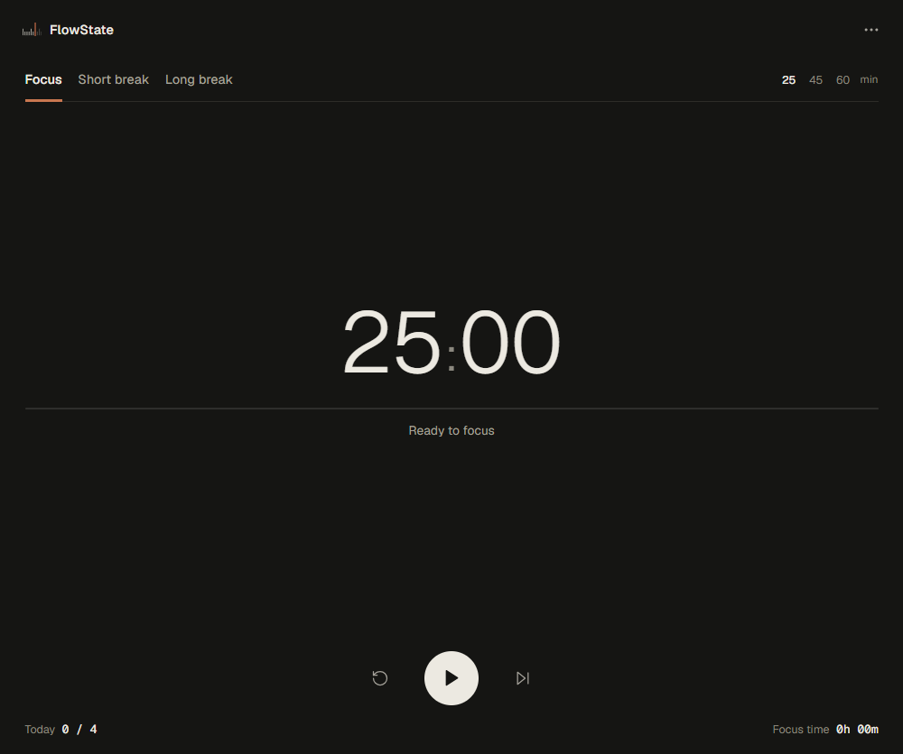
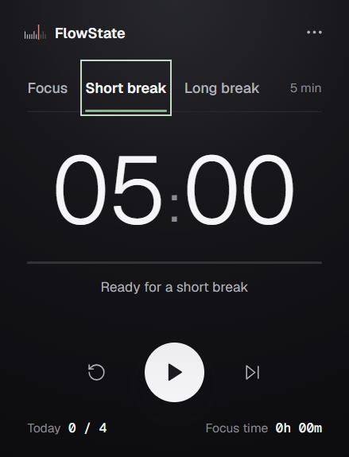
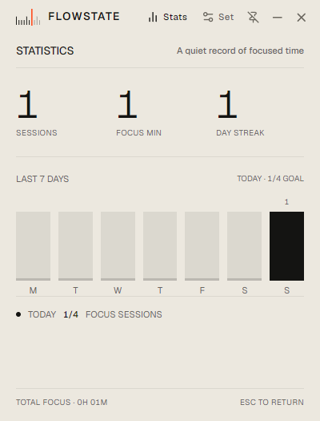

# FlowState

<p align="center">
  
</p>

A compact, local-first desktop focus timer. Start a session, take a break, and come back to work without a bigger productivity system.

**Website:** [FlowState on GitHub Pages](https://dustin04x.github.io/FLOWSTATE/)

The site publishes from `main` through GitHub Actions.

## Download

Current release: **v1.0.0**

| Platform | Download |
|---|---|
| Windows | [Installer](https://github.com/dustin04x/FLOWSTATE/releases/download/v1.0.0/FLOWSTATE.Setup.1.0.0.exe) |
| macOS — Apple Silicon | [DMG](https://github.com/dustin04x/FLOWSTATE/releases/download/v1.0.0/FLOWSTATE-1.0.0-arm64.dmg) |
| macOS — Intel | [DMG](https://github.com/dustin04x/FLOWSTATE/releases/download/v1.0.0/FLOWSTATE-1.0.0-x64.dmg) |
| Linux — Ubuntu/Debian | [`.deb`](https://github.com/dustin04x/FLOWSTATE/releases/download/v1.0.0/FLOWSTATE-1.0.0-amd64.deb) · [AppImage](https://github.com/dustin04x/FLOWSTATE/releases/download/v1.0.0/FLOWSTATE-1.0.0-x86_64.AppImage) |

The Windows installer is unsigned and may show a SmartScreen warning. The macOS app is unsigned and not notarized; Gatekeeper may warn or block it. Linux and macOS package behavior has not been verified on physical systems.

The published v1.0.0 files keep their original `FLOWSTATE` filenames and in-app casing. New packages use the `FlowState` spelling.

## What it does

- Focus presets of 25, 45, and 60 minutes, plus adjustable focus time.
- Configurable short and long breaks, daily goals, and optional automatic starts.
- Tray controls; hiding the window does not stop a session.
- Daily progress, recent activity, total focus time, completed sessions, and a streak.
- Settings and session history stay on your device. There is no account or sync service.

## Screenshots

These are captures of the actual Windows app.

| Focus | Break | Activity |
|---|---|---|
|  |  |  |

## Run from source

Requires Node.js and npm.

```powershell
git clone https://github.com/dustin04x/FLOWSTATE.git
cd FLOWSTATE
npm ci
npm run dev
```

Run the app checks and build:

```powershell
npm test
npm run typecheck
npm run build
```

Run or build the website separately:

```powershell
npm run website:dev
npm run website:build
```

## Credits and license

Founded and created by **Skander Wali**.

FlowState is available under the [MIT License](./LICENSE).
