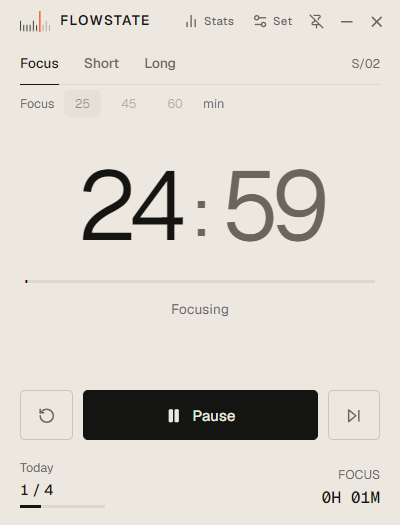
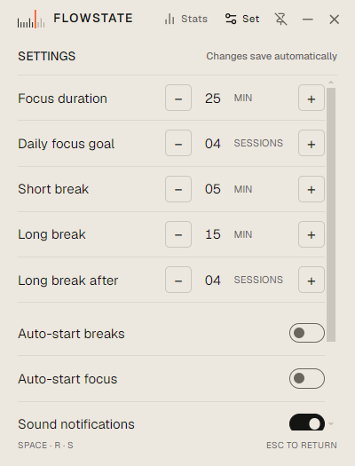

<div align="center">
  
  <p>A compact, local-first focus timer for the Windows desktop.</p>
  
</div>

## About

FLOWSTATE is a small desktop utility for settling into a focus session, taking a break, and getting back to work. It keeps the timer close and the rest of the productivity machinery out of the way.

The window is compact, can stay above other windows, and can hide to the system tray without stopping a session. Settings and session history stay on your device; there is no account or sync service.

## Screenshots

These are captures of the Windows Electron app, not mockups.

| Focus, ready | Focus, running |
|---|---|
|  |  |

| Break mode | Settings |
|---|---|
|  |  |

| Statistics |
|---|
|  |

The native tray menu is not pictured: capturing it in this environment would also expose unrelated notification-area icons. Its controls are listed above.

## Features

- Focus presets of 25, 45, and 60 minutes, plus an adjustable focus duration.
- Configurable daily focus goal and short/long break durations.
- Focus and break sequencing, with optional automatic starts and a configurable long-break interval.
- Daily goal progress, a seven-day activity view, total focus time, completed sessions, and current streak.
- Settings, timer state, and activity history stored locally.
- Close-to-tray behavior; the timer continues while the window is hidden.
- Tray controls for starting or pausing, choosing a focus preset, resetting or skipping a session, showing the window, and quitting.
- Always-on-top window option and launch-at-startup setting (Windows and macOS code paths; packaged behavior outside Windows has not been verified).
- Locally synthesized sound notifications; no network service is used.

## Interface

The focus screen uses warm paper (`#ECE8DF`) and ink (`#141412`), with muted gray (`#8B867B`) for secondary information. Signal orange (`#FF4D1F`) marks the timer’s progress and the playhead in the FLOWSTATE ruler symbol. Breaks invert the paper and ink.

Geist handles interface text and large timer numerals; Geist Mono is used for compact measurements. Both font families ship with the app, so the interface does not depend on a remote font service.

## Install on Windows

Download the [Windows installer for FLOWSTATE 1.0.0](https://github.com/dustin04x/FLOWSTATE/releases/download/v1.0.0/FLOWSTATE.Setup.1.0.0.exe) from GitHub Releases.

The installer is unsigned, so Windows may show a SmartScreen warning when it is opened.

## Keyboard shortcuts

Shortcuts are handled by the app window and are ignored while focus is in a text field.

| Shortcut | Action |
|---|---|
| `Space` | Start, pause, or resume the timer |
| `R` | Reset the current session |
| `S` | Skip the current session |
| `Ctrl+,` (`⌘,` on macOS) | Open settings |
| `Ctrl+I` (`⌘I` on macOS) | Open statistics |
| `Escape` | Return to the timer |

The timer controls also show their keyboard shortcuts in the app.

## Architecture

- **Electron main process** (`electron/main.ts`) owns the frameless window, native tray menu, window placement, close-to-tray behavior, and native window settings.
- **Preload** (`electron/preload.ts`) exposes a narrow `window.flowstate` API through `contextBridge`. Context isolation and sandboxing are enabled; Node integration is disabled.
- **React renderer** (`src/App.tsx`) presents the timer, settings, and statistics. Preferences and activity are persisted in local storage.
- **Timer engine** (`src/engine/timer.ts`) calculates time from deadlines, so hiding the window does not pause a running session.
- **Vite** serves the renderer during development and builds the production UI.

The renderer requests native actions through the preload API; it does not access Node.js or Electron IPC directly.

## Project structure

```text
assets/
  flowstate-logo.svg
  flowstate-mark.svg
  flowstate-mark.png
  flowstate-tray.png
  flowstate.ico
docs/
  assets/
    break-mode.png
    focus-idle.png
    focus-running.png
    settings.png
    statistics.png
electron/
  main.ts
  preload.ts
  tsconfig.json
src/
  components/
    SettingsView.tsx
    StatsView.tsx
    TimerView.tsx
    WindowHeader.tsx
    WindowHeader.test.tsx
  engine/
    timer.test.ts
    timer.ts
  App.tsx
  global.d.ts
  main.tsx
  styles.css
index.html
package.json
vite.config.mts
```

## Development

Requires Node.js and npm. From PowerShell:

```powershell
git clone https://github.com/dustin04x/FLOWSTATE.git
cd FLOWSTATE
npm ci
npm run dev
```

Run the checks and build:

```powershell
npm run test
npm run typecheck
npm run build
```

Package the Windows installer:

```powershell
npm run dist:win
```

The installer is written to `outputs/final-release/`; generated build and installer files are ignored by Git. A Linux packaging script exists in `package.json`, but Linux packaging and desktop integration have not been verified. No macOS release package is configured.

## Contributing

Issues and focused pull requests are welcome. For a larger change, open an issue first to agree on scope. Include tests for timer-engine changes and note any manual checks for UI or Electron behavior.

## Roadmap

Possible follow-up work—not implemented or scheduled—includes signing Windows builds, validating packaging on Linux desktops, and automating release checks.

## License

FLOWSTATE is available under the [MIT License](./LICENSE).
